<p align="center">
  
</p>

<p align="center">
  
</p>

<p align="center">
  
  
  
  
  
</p>

> Proyecto de tesis de pregrado: adaptación de modelos de lenguaje pequeños (1–1,5 B parámetros) al dominio
> del maíz (enfermedades foliares, manejo, productos registrados en Colombia y EE. UU.), e integración del
> modelo resultante en una app Android que corre **100 % local, sin internet**, en un celular de gama media
> (6 GB RAM en adelante). Este repositorio cubre la parte de **integración**; el entrenamiento y la minería
> de datos se hicieron en Google Colab / Drive (ver [`colab/`](colab/) y la sección "Pipeline" más abajo).

> **Nota sobre las animaciones de este README:** Markdown de GitHub no ejecuta JS/CSS propio, así que el
> "movimiento" de arriba son imágenes **SVG animadas** servidas por dos proyectos de terceros muy usados en
> READMEs de GitHub — [`capsule-render`](https://github.com/kyechan99/capsule-render) (el encabezado con
> olas) y [`readme-typing-svg`](https://github.com/DenverCoder1/readme-typing-svg) (el texto que se escribe
> solo). Son imágenes externas cargadas en cada visita, no contenido que viva en este repo.

---

## 🚦 Estado actual

<p align="left">
  
  
  
  <br/>
  
  
  <br/>
  
  
</p>

## 🏆 El modelo ganador, y por qué

De tres familias entrenadas con DAPT + QLoRA sobre el mismo corpus, **Llama 3.2 1B Instruct + DAPT con la
mezcla M2** es el que se llevó a producción:

| Modelo | Benchmark total | PPL dominio (vs. base) | Costo de entrenamiento |
|---|---|---|---|
| Llama 3.2 1B base | 49,1 % | — | — |
| **Llama 3.2 1B DAPT M2** | **60,2 %** | **−52,0 %** | 14,7 h · 1,03 kWh |
| Qwen 2.5 1.5B DAPT M2 | 60,1 % | −41,9 % | 24,1 h · 1,68 kWh |
| Gemma 3 1B DAPT M0 | 53,9 % | −74,4 %* | 3,9 h · 0,27 kWh |

\* La perplejidad base de Gemma está inflada por un problema de tokenización (falta `<bos>`); no es
comparable directamente. Ver detalle completo en el documento de contexto del proyecto.

Llama M2 empata con Qwen 1,5B (McNemar, p_Holm = 1) siendo más pequeño y con 38 % menos energía de
entrenamiento — la razón por la que es el elegido para correr en un teléfono. Sobre él se hizo el SFT que
usa esta app (`runs/colab_sft_v1_llama32_1b/adapter` en Drive: DAPT M2 + SFT en un solo adaptador LoRA).

<details>
<summary>Alternativas descartadas para la app (clic para expandir)</summary>

- `colab_dapt_llama32_1b_M2/adapter` (sin SFT): benchmark algo mejor (60,2 % vs 58,4 %) pero sin formato de
  chat en 3 niveles ni cita de fuente.
- `colab_dapt_qwen25_15b_M2/adapter`: mismo nivel de precisión, modelo más grande y más lento.

</details>

## 🔄 Pipeline completo

```mermaid
flowchart LR
    A[Minería\nOpenAlex · DSpace · Europe PMC\nPDFs · registros ICA/EPA] --> B[Limpieza + dedup\n+ partición\ncorpus v1: 41.573 docs]
    B --> C[Mezclas de entrenamiento\nM0 / M1 / M2]
    C --> D[DAPT con QLoRA\nColab GPU L4\n3 familias de modelos]
    D --> E[Evaluación\nperplejidad · olvido\nbenchmark · McNemar+Holm]
    E --> F[Selección del modelo final\nLlama 3.2 1B DAPT M2]
    F --> G[SFT\nprofesor Qwen2.5-7B\n3 niveles x 2 idiomas]
    G --> H[Fusión adaptador\n+ GGUF + Q4_K_M]
    H --> I[App Android\nKotlin + llama.cpp/JNI\nchatbot on-device]

    style H fill:#1a73e8,color:#fff
    style I fill:#34a853,color:#fff
```



El código y los datos de entrenamiento viven en Google Drive (`maize_llm_colab/`, `maize_llm/runs/`); no
están en este repositorio porque incluyen artefactos grandes (checkpoints, corpus). El script que fusiona
el adaptador y genera el GGUF cuantizado está en [`colab/preparar_modelo_android.py`](colab/preparar_modelo_android.py)
(pensado para correr como notebook de Colab, celda por celda).

## ⚠️ Riesgos conocidos del modelo (importantes para cómo se construye la app)

Documentados en el proyecto original y confirmados con una prueba real sobre el GGUF ya cuantizado:

- **Las fuentes que cita el modelo pueden ser inventadas.** Ejemplo real observado: ante una pregunta sobre
  la mancha de asfalto del maíz (causada por *Phyllachora maydis*), el modelo citó un artículo sobre
  *Aspergillus flavus* (una enfermedad distinta). El modelo aprendió a terminar con "Fuente: …" de memoria,
  no a partir de un fragmento recuperado. Mitigación recomendada: RAG, mostrando al usuario la fuente
  **recuperada**, no la que el modelo escriba.
- **9,8 % de las respuestas** traen una cifra con unidad (L/ha, kg/ha, g/L, %, días) que no está respaldada
  por la referencia — posible dosis inventada. La app no debe mostrar dosis generadas por el modelo sin
  verificarlas contra el registro ICA/EPA.
- Exactitud de ~60 % en un benchmark de opción múltiple (azar = 25 %): el modelo es un apoyo, no una
  recomendación agronómica definitiva.
- En el nivel agricultor en inglés, 93,3 % de las respuestas salen en el idioma pedido (en el resto de
  combinaciones, 100 %); hay que forzar y verificar el idioma en la app.

## 📁 Estructura de este repositorio

```
colab/      scripts pensados para correr en Google Colab (fusión de adaptador, GGUF, evaluación)
app/        (próximamente) proyecto Android/Kotlin del chatbot
```

## 📜 Licencia del modelo base

El modelo usa `meta-llama/Llama-3.2-1B-Instruct` como base, que requiere aceptar la licencia de Meta en
Hugging Face. El adaptador LoRA entrenado en este proyecto no tiene esa restricción, pero el modelo
fusionado hereda los términos de la licencia de Llama.

<p align="center">
  
</p>
